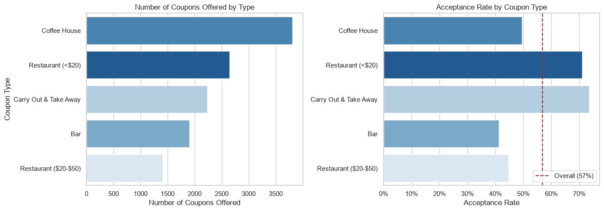
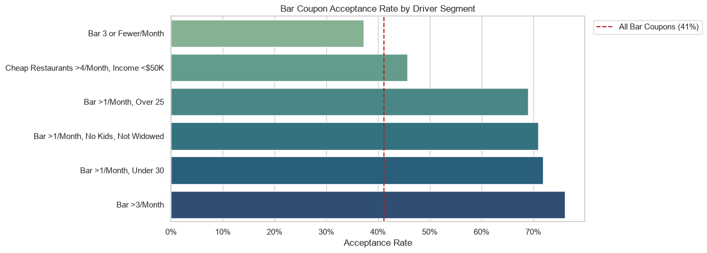
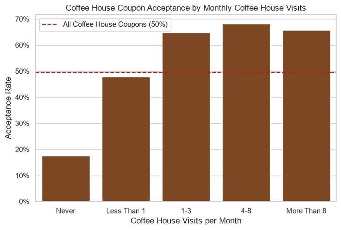

# Will the Customer Accept the Coupon?

**Practical Application 1: UC Berkeley Professional Certificate in Machine Learning & AI**

**Full analysis notebook:** [coupon_acceptance_analysis.ipynb](coupon_acceptance_analysis.ipynb)

## Overview

Drivers in an Amazon Mechanical Turk survey were shown a driving scenario (destination, time of day, weather, passengers) and a coupon for a nearby business, then asked whether they would use it. The goal of this project is to describe how drivers who **accepted** a coupon differ from drivers who **rejected** it, so that coupons can be sent to the people most likely to respond.

The data ([UCI Machine Learning Repository](https://archive.ics.uci.edu/dataset/603/in+vehicle+coupon+recommendation)) covers 12,684 responses across five coupon types: coffee houses, bars, carry out & take away, cheap restaurants (under \$20), and more expensive restaurants (\$20-\$50).

## Summary of Findings

### Overall

- **57%** of coupons were accepted.
- Carry out (73%) and cheap restaurant (71%) coupons are the easiest sells. Bar (41%) and expensive restaurant (44%) coupons are the hardest.

### Bar coupons (41% accepted)

- **Habit is everything.** Drivers who already go to a bar more than 3 times a month accepted **76%** of bar coupons, about twice the rate of everyone else (37%).
- Regular bar-goers (more than once a month) who are **under 30**, or who **don't have kids in the car**, accepted about **71-72%**.
- Income and how often someone eats at cheap restaurants made little difference.

### Coffee House coupons (50% accepted): independent investigation

Coffee House coupons are sent most often (about 1 in 3 coupons) but only half are accepted, so better targeting has the biggest payoff here.

- **Habit matters most.** Drivers who visit a coffee house at least once a month accepted **66%** of coupons, about twice the rate of those who go less often (34%). Drivers who never go accepted only **18%**.
- **Younger and lower-income regulars respond best.** Regular coffee house visitors under 30 accepted **69%**, and regulars with an income under \$50K accepted **70%**.
- **Demographics alone barely matter.** Gender, children and most age and income groups were all close to the 50% average.

## Recommendations

1. **Target by habit first.** Send Bar and Coffee House coupons mainly to people who already visit those places at least once a month.
2. **Stop sending Coffee House coupons to people who never go** (18% acceptance).
3. **Among coffee regulars,** prioritize drivers under 30 and those with an income under \$50K.
4. **For bars,** focus on regular bar-goers under 30 and never send bar coupons when children are in the car.

## Next Steps

- Build a predictive model (e.g. logistic regression or a decision tree) to rank which factors matter most when considered together.
- Explore situational factors such as time of day, destination and coupon expiration, which this analysis did not cover.
- Extend the analysis to the Carry out and Restaurant (\$20-\$50) coupon groups.
- Validate with real redemption data, since this survey asked about hypothetical scenarios.

## Repository Contents

| Path | Description |
| --- | --- |
| `coupon_acceptance_analysis.ipynb` | Jupyter notebook with data cleaning, analysis, visualizations and findings |
| `data/coupons.csv` | Survey dataset from the UCI Machine Learning Repository |
| `images/` | Charts generated by the notebook |

**Libraries used:** pandas, NumPy, Matplotlib, seaborn
